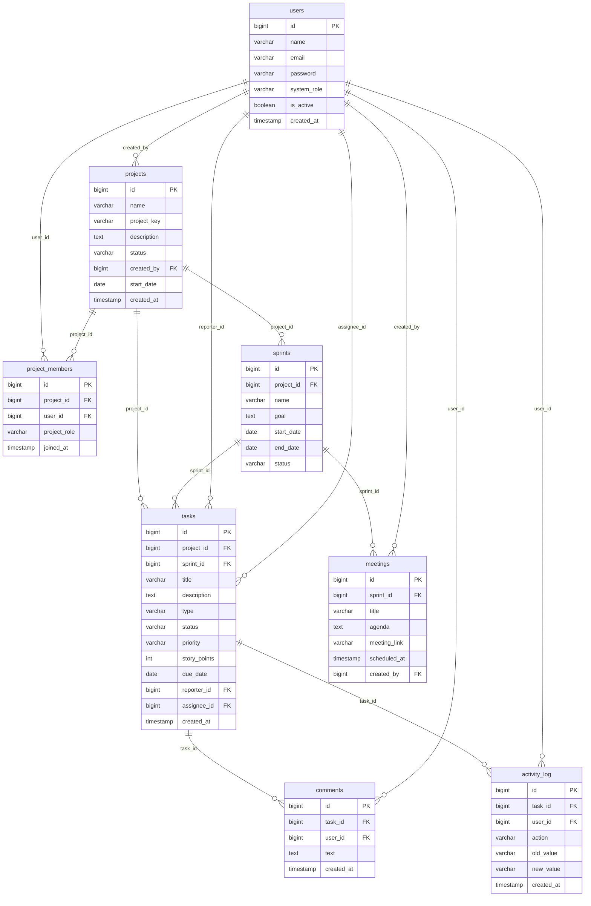

# Mini-Jira

> **Status:** 🟡 In Active Development | Architecture & Specification Phase

MiniJira is a lightweight agile task tracking and project management system where cross-functional teams manage projects, sprints, and tasks with role-based access control.

---

## 🛠 Tech Stack

- **Backend:** Java 21, Spring Boot 3 (Spring Web, Spring Security, Spring Data JPA)
- **Database:** PostgreSQL
- **Security:** JWT (JSON Web Tokens) with Role-Based Access Control
- **API Documentation:** Swagger / OpenAPI 3
- **Testing:** JUnit 5, Mockito, Testcontainers
- **Containerization:** Docker & Docker Compose (Multi-container: Spring Boot App + PostgreSQL)

---

## 👥 User Roles & Permissions

The application uses a **two-tier role system**: Global System Roles and Project-Level Roles.

### 1. System Roles (Global)
- **ADMIN:** Manages all user accounts (block/unblock, change system roles, reset passwords) and global application settings.
- **USER:** Standard authenticated user who can be invited to projects and assigned specific project roles.

### 2. Project-Level Roles (Assigned Per Project)

- **Role Assignment Rule:** Each member has **exactly one role per project**. The same user can have different roles in different projects (e.g., a user can be a Developer in Project A, but a Project Manager or Tester in Project B).
- **Project Creation:** Any **USER** can create a project and automatically becomes its **Project Manager**.

The 4 project roles are:
- **PROJECT_MANAGER:** Manages project settings, assigns team members with project roles, and **handles backlog prioritization**.
- **SCRUM_MASTER:** Facilitates sprint planning, sets sprint goals/durations, moves prioritized backlog items into sprints, and schedules daily standup meetings.
- **DEVELOPER:** Estimates story points, takes ownership of assigned tasks, transitions tasks through development, and posts comments.
- **TESTER:** Validates completed tasks against acceptance criteria, logs defects/bugs, and approves (`Done`) or reopens (`In Progress`) tasks.

### 3. Project Role Permission Matrix

| Action / Permission | Project Manager | Scrum Master | Developer | Tester |
| :--- | :---: | :---: | :---: | :---: |
| **Edit Project Settings & Member Roles** | ✅ | ❌ | ❌ | ❌ |
| **Prioritize Product Backlog** | ✅ | ❌ | ❌ | ❌ |
| **Create, Start & Complete Sprints** | ✅ | ✅ | ❌ | ❌ |
| **Schedule Daily Standup Meetings** | ❌ | ✅ | ❌ | ❌ |
| **Create Tasks & User Stories** | ✅ | ✅ | ✅ | ❌ |
| **Report / Log Bugs & Defects** | ✅ | ✅ | ✅ | ✅ |
| **Assign / Reassign Tasks** | ✅ | ✅ | ❌ | ❌ |
| **Estimate Story Points** | ✅ | ✅ | ✅ | ❌ |
| **Move Tasks: Backlog → To Do** | ✅ | ✅ | ❌ | ❌ |
| **Move Tasks: To Do → In Progress → In Testing** | ❌ | ❌ | ✅ (Assigned) | ❌ |
| **Verify Tasks: In Testing → Done / Reopen** | ❌ | ❌ | ❌ | ✅ |
| **Post Comments & View Dashboard** | ✅ | ✅ | ✅ | ✅ |

### 4. Task Status Transition Rules

| Transition | Who can do it |
| :--- | :--- |
| **Backlog → To Do** | Project Manager, Scrum Master (when added to a sprint) |
| **To Do → In Progress** | Assigned Developer |
| **In Progress → In Testing** | Assigned Developer |
| **In Testing → Done** | Tester |
| **In Testing → In Progress (reopen)** | Tester |

---

## 🗄️ Database Schema & Entity Relationships

The relational data model (designed via `dbdiagram.io`) maps the complete project lifecycle across 8 core PostgreSQL tables:



---

## ⚖️ Core Business Rules

1. **User & Identity Rules:**
   - User emails must be unique and normalized to lowercase.
   - Passwords must be securely hashed with BCrypt (`strength = 12`).
   - Inactive users (`is_active = false`) cannot authenticate or be assigned tasks.
   - An `ADMIN` cannot deactivate or revoke admin privileges from their own account.

2. **Project & Membership Rules:**
   - Each project requires a unique, uppercase identifier `project_key` (e.g., `JIRA`, `PROJ`).
   - Any `USER` can create a project and automatically assumes the `PROJECT_MANAGER` role.
   - **Single Role Constraint:** Each member has strictly one role per project.
   - Only the `PROJECT_MANAGER` can invite members or modify member roles within their project.

3. **Sprint & Backlog Rules:**
   - Each project can have at most **one active sprint** at any given time.
   - Sprint `end_date` must be strictly after `start_date`.
   - Tasks created without a sprint remain in the Project Backlog (`sprint_id = null`).
   - Only tasks attached to an active sprint can transition from `Backlog` to `To Do`.

4. **Task & Workflow Rules:**
   - Status transitions must follow the authorized workflow state machine.
   - Only the assigned `DEVELOPER` can move a task to `In Progress` or submit to `In Testing`.
   - Only a `TESTER` can transition a task to `Done` or reopen it (`In Testing` ➔ `In Progress`).
   - Tasks cannot be hard deleted once work has commenced; they must be transitioned to `Done` or closed.

5. **Audit Logging Rules:**
   - All task status changes, point re-estimations, and reassignment actions must generate an immutable record in `activity_log`.
   - Comments are append-only; users cannot edit or delete comments authored by other members.

---

## 📋 Features

### 🔐 User & Access Management
- [ ] **User Registration & Authentication:** Secure registration and JWT-based login for all users.
- [ ] **Admin User Management:** Admin dashboard to view all users, block/unblock accounts, change system roles (Admin/User), and trigger password resets.
- [ ] **Role-Based Access for Projects:** Assign project-specific roles (Project Manager, Scrum Master, Developer, Tester) with granular permissions.

### 📁 Project & Sprint Planning
- [ ] **Project Creation & Management:** Create, configure, and manage projects and member rosters.
- [ ] **Sprint Planning & Lifecycle:** Create sprints, set sprint goals/timelines, move backlog items into active sprints, and complete sprints.
- [ ] **Daily Standup / Meeting Scheduling (Low Priority):** Schedule daily meetings and agendas tied to active sprints (implemented after core sprint workflows).

### 📝 Task & Issue Tracking
- [ ] **Task & Issue Creation:** Create Tasks, User Stories, and Bugs with rich descriptions and issue types.
- [ ] **Priority & Story Point Estimation:** Estimate task complexity via story points and set priority levels (`Low`, `Medium`, `High`, `Critical`).
- [ ] **Task Assignment & Activity Tracking:** Assign tasks to specific team members and maintain an audit log of all changes.
- [ ] **Search, Filter, Sorting & Pagination:** Advanced querying of tasks by status, priority, assignee, and sprint, with multi-field sorting and server-side pagination.
- [ ] **Task Comments:** Plain text comments on tasks for communication between team members (no nested replies).

### 🔄 Workflow, Quality Assurance & Metrics
- [ ] **Status Workflow Management:** Enforce state transitions: `Backlog` ➔ `To Do` ➔ `In Progress` ➔ `In Testing` ➔ `Done`.
- [ ] **Status Updates & Board Transitions:** Update and move tasks across the sprint/Kanban board.
- [ ] **Testing & Quality Assurance Workflow:** Dedicated QA step for Testers to verify work, test acceptance criteria, log defects, and approve or reopen issues.
- [ ] **Project & Sprint Dashboard:** Overview analytics displaying task counts per status, overdue task alerts, and sprint completion metrics.

### ⚙️ Developer Experience & DevOps
- [ ] **Swagger/OpenAPI Documentation:** Interactive API documentation for all REST endpoints with Swagger UI.
- [ ] **Unit & Integration Testing:** Comprehensive automated test suite using JUnit 5, Mockito, and Testcontainers.
- [ ] **Dockerized Application:** Complete multi-container orchestration via Docker Compose running both the Spring Boot app and PostgreSQL.

---

## 🎯 Stretch Goals (Days 28–30)

Optional enhancements to tackle only after all core features, tests, and documentation are fully delivered:
- [ ] **Third-Party OAuth2 Integration:** Social login via Google or GitHub OAuth2 alongside standard registration/JWT auth.
- [ ] **Email Notification Dispatch:** Automated email notifications for task assignments and critical bug alerts (via Spring Mail / SendGrid API).

---

## 🚫 Out of Scope

To prevent scope creep and ensure on-time delivery, the following features are explicitly excluded:
- **File & Media Attachments:** No file/image upload storage (e.g., S3 or local multipart uploads) on tasks or comments.
- **Custom Workflows:** Statuses and transitions are strictly limited to the 5 predefined states (no user-configured state machines).
- **Subtasks & Epics Hierarchy:** Tasks maintain a flat structure (`BUG`, `STORY`, `TASK`) without parent-child nesting.
- **Burndown Charts & Advanced Analytics:** No complex velocity/burndown graph engines (dashboard provides count-based metrics only).
- **Drag-and-Drop Kanban UI:** Backend provides standard status update endpoints; frontend drag-and-drop animation/state is excluded.
- **Real-Time Video/Audio Calling:** Standup meetings track meeting links and agendas only (no embedded WebRTC).
- **Multi-Tenant Billing & Payment Gateways:** No payment gateways, pricing tiers, or subscription models.
- **SMS Notifications:** SMS dispatch is not supported (email is reserved for stretch goals).
- **Mobile Applications:** No native iOS or Android mobile clients.

---

## 🚀 Getting Started

### Prerequisites
- JDK 21
- Docker & Docker Compose

### Option A: Run Entire Stack with Docker (App + PostgreSQL)
```bash
# Build and run both PostgreSQL and Spring Boot App
docker compose up --build -d
```
- API Base URL: `http://localhost:8080`
- Swagger UI Documentation: `http://localhost:8080/swagger-ui/index.html` (or `http://localhost:8080/swagger-ui.html`)
- OpenAPI 3 Specification: `http://localhost:8080/v3/api-docs`

### Option B: Run Locally (Database in Docker, App in IDE/CLI)
1. Start the PostgreSQL database:
   ```bash
   docker compose up postgres -d
   ```
2. Run the Spring Boot application:
   ```bash
   ./mvnw spring-boot:run
   ```
3. Run test suite:
   ```bash
   ./mvnw test
   ```

---

### 🔒 Docker, Environment & Secrets Management

- **Environment File Configuration:** Copy `.env.example` to `.env` before starting containers. Never commit `.env` or production credentials to Git.
  ```bash
  cp .env.example .env
  ```
- **Secrets Management:** Sensitive keys (`JWT_SECRET`, database passwords) must be injected via environment variables and excluded from `application.yml` defaults.
- **Data Persistence:** PostgreSQL data is persisted via a named Docker volume (`postgres_data`) so database state survives container restarts.
- **Default Development Ports:**
  - Spring Boot Backend: `8080`
  - PostgreSQL Database: `5432`
